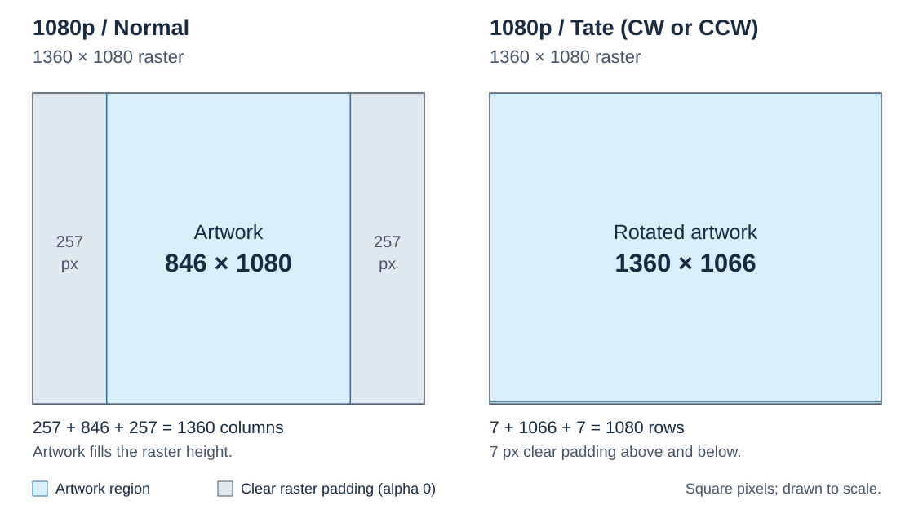
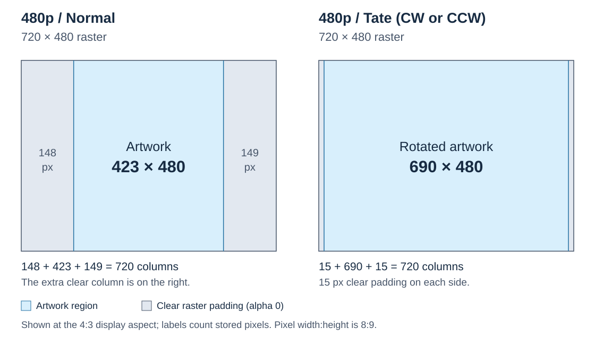

# Artwork tools: technical reference

For installation, see [Setup in the Overlay Tools guide](README.md#setup).
That guide also includes everyday build and extraction examples.

This reference describes image processing, file geometry and all
command-line options.

- `build_art.py`: source PNG to normal, 90CW and 90CCW `.art` packages, each
  containing 1080p, 720p, 480p and 240p planes; also supports pack and extract.
- `vart_encoder.py`: VART encoder/decoder, kept beside the generator.
- `quantize_art.cjs`: Sharp/libimagequant palette backend.
- `package.json`: declares the pinned Sharp dependency and Node requirement.

## Command-line conventions

Run these commands from the `Overlay Tools` folder. Put global options
before the `build`, `build-all`, `pack` or `extract` command:

```text
python -B build_art.py build INPUT.png -o OUTPUT_DIR
python -B build_art.py --saturation 0.70 build INPUT.png -o OUTPUT_DIR
python -B build_art.py --max-colors 256 build INPUT.png -o OUTPUT_DIR
python -B build_art.py --max-colors 16 pack PLANE_DIR OUTPUT.art
python -B build_art.py --help
```

For `build` and `build-all`, output directories are optional. With no `-o`,
all three orientations go to the process's current working directory. One
`-o DIR` places all three in that directory. Repeat the option to send Normal
to the first directory and both CW/CCW packages to the second:

```text
python build_art.py build INPUT.png
python build_art.py build INPUT.png -o OUTPUT_DIR
python build_art.py build INPUT.png -o NORMAL_DIR -o TATE_DIR
python build_art.py build-all INPUT_DIR -o NORMAL_DIR -o TATE_DIR
```

Each `-o` / `--outdir` occurrence takes exactly one directory. At most two
are accepted; extra occurrences are rejected before processing. Destination
directories are created as needed. Relative paths are resolved against the
current working directory, and paths containing spaces must be quoted. These
choices route the orientation packages without changing their content.

CW and CCW share the same colors and alpha values at each resolution. CCW is
an exact 180-degree rotation of the finished CW image, with no second palette
reduction or additional resampling.

`pack` takes a positional output filename. `extract` requires one
`-o` / `--outdir` directory for its PNG output.

## Pack separately prepared resolution images

Use `pack` when each output resolution has already been authored as a
complete raster. The input directory must contain all four exact-size PNGs:

| Filename | Dimensions |
| --- | --- |
| `1080p.png` | 1360x1080 |
| `720p.png` | 916x720 |
| `480p.png` | 720x480 |
| `240p.png` | 720x240 |

```text
python build_art.py pack PLANE_DIR OUTPUT.art
```

This creates one orientation package. It validates input dimensions and applies
the selected palette limit. Alpha is normalized by default; `--preserve-alpha`
retains every input alpha byte. It does not resize, rotate or desaturate these
authored planes.

## Palette and alpha

The alpha channel distinguishes opaque artwork from translucent regions
where the game remains visible. It lets the core adjust the brightness of
these two parts independently. Use **255 for opaque** artwork and **51 for
translucent** artwork. A PNG without an alpha channel is treated as fully
opaque unless you supply a separate alpha map.

The renderer supports the full **0–255** alpha range in each palette entry.
Only **255** selects Opaque Brightness and blocks the beam completely.
Values **1–254** use Translucent Blend and retain their numeric strength for
artwork brightness and beam tinting; **0** contributes no artwork or tint.
These calculations use fixed-point rounding, so adjacent alpha values may
produce the same displayed result. Tint strength can also saturate; this does
not turn a value below 255 into an opaque beam mask. To retain authored levels
other than 51, use `--preserve-alpha`.

### Palette reduction

`--max-colors` (alias `--max_color`) accepts **16, 64 or 256**, with **64** as
the default RGBA entry ceiling per plane for `build`, `build-all` and `pack`.
Every distinct RGB/alpha combination and transparent margin entry counts.
The limit is a ceiling, not a forced palette size. All 256 entries are usable.
Unused entries in an input PNG's palette do not count toward the limit.
Each output plane receives its own palette at the selected limit.

A prepared plane that fits the selected limit is indexed losslessly,
without Node.js. For example, 57 used RGBA values fit a 64-entry palette;
200 values fit a 256-entry palette but require reduction at a limit of 64.
The count is taken after image preparation, including resizing and padding.

Planes exceeding the limit use Sharp/libimagequant for palette reduction.
If Node.js or Sharp is missing when reduction is needed, the command stops
with a setup error. See [Setup](README.md#setup) for installation.

### Preserve embedded PNG alpha

Use `--preserve-alpha` with `build`, `build-all` or `pack` to use the PNG's own
alpha map. It bypasses both `--alpha-cutoff` and automatic exterior correction:

```text
python build_art.py --preserve-alpha build INPUT.png -o OUTPUT_DIR
python build_art.py --preserve-alpha --max-colors 256 build INPUT.png -o NORMAL_DIR -o TATE_DIR
python build_art.py --preserve-alpha pack PLANE_DIR OUTPUT.art
```

For an 846x1080 input, the normal 1080p artwork retains every alpha byte,
including values such as 64, 180 and 254. `pack` preserves every input alpha
byte in all four planes. Palette reduction changes RGB only.

When resizing is necessary, the map follows the artwork geometry. Translucent
levels are selected by coverage, without averaging alpha or converting it to
51; equal coverage selects the lower value. The existing opaque-detail
preservation still applies. Cropping, opaque black width padding and clear
raster margins follow the framing rules below. Resizing can remove regions
smaller than a destination pixel.

Each distinct RGB/alpha combination consumes a palette entry. If the alpha
levels alone exceed `--max-colors`, the build fails rather than changing them.
Choose a larger palette limit or simplify the input map. A PNG without alpha
is still fully opaque. `--preserve-alpha` cannot be combined with `--alpha-map`,
which supplies a replacement map instead.

### Source alpha and custom maps

The source-alpha cutoff defaults to **153**. Use `--alpha-cutoff N` to choose
an integer from **1 to 255**: nonzero source values below the cutoff become
**51**, and values at or above it become **255**. Fully clear regions retain
alpha 0, subject to the exterior option described below. For example, to
treat only source values of 250 and above as opaque:

```text
python build_art.py --alpha-cutoff 250 build INPUT.png -o OUTPUT_DIR
```

If in doubt about the source alpha, supply your own reviewed map. Save it
as a grayscale PNG with the **same dimensions as the original input image**,
using only **51 for translucent regions** and **255 for opaque regions**:

```text
python -B build_art.py build INPUT.png --alpha-map REVIEWED_ALPHA.png -o OUTPUT_DIR
```

The same option works with a chosen palette limit and separate output folders:

```text
python build_art.py --max-colors 256 build INPUT.png --alpha-map REVIEWED_ALPHA.png -o NORMAL_DIR -o TATE_DIR
```

A supplied map's **51 and 255 values are accepted unchanged**: it replaces
the image's alpha and bypasses both `--alpha-cutoff` and automatic exterior
correction. The input PNG must already have the intended exterior color.
The map is cropped or resized together with the artwork for every output
resolution and orientation.

`--alpha-map` is available only with `build`. Use separate `build` commands
for images that need individual maps. `pack` uses the alpha already present
in its four input planes and applies the same numeric normalization unless
`--preserve-alpha` is set.
Extraction preserves stored RGB and alpha without further adjustment.

## Centering and image options

The usual input is an **846x1080 PNG**. Images 1080 pixels high and 840-854
pixels wide are centered to 846x1080 without resizing. Narrower images get
opaque black padding; wider images are cropped. If an odd number of columns
must be added or removed, the extra column is on the right.

All output resolutions and orientations use that adjusted framing. Images
with other dimensions are resized to 846x1080 before generating the packages.

### Artwork inside the renderer raster

Each stored plane contains the artwork inside a larger renderer raster.
The builder positions the artwork and adds **clear padding (alpha 0)** to
fill that raster. This padding is separate from any border or notch in the
artwork itself. You normally supply the 846x1080 PNG; the builder creates
the complete planes automatically.

At **1080p**, normal artwork fills the raster height, with 257 clear pixels
on each side. For **Tate**, the builder turns the artwork 90 degrees CW or
CCW, then fits it to the raster: 1360x1066 artwork with 7 clear rows above
and below. CW and CCW use the same bounds.



At **480p**, the 720x480 raster is displayed at **4:3**, so its pixels are
not square. The builder accounts for this to keep the artwork's proportions.
Normal artwork is 423x480, with 148 clear columns on the left and 149 on
the right. Tate artwork is 690x480, with 15 clear columns on each side.
Both fill the raster height. A viewer that treats these stored pixels as
square will make the artwork look wider than intended.



The other resolutions follow the same fitting rules; their exact artwork
and raster dimensions are listed under [Extract PNGs from an ART file](#extract-pngs-from-an-art-file).
Default extraction returns the colored artwork rectangle shown in these
diagrams. Use `--full-plane` to include the clear raster padding as well.

### Exterior, saturation and resizing options

By default, detected exterior corners and notches are made opaque black.
Use `--exterior clear` to retain their clear source alpha. Added width
padding remains opaque black with either setting. `--alpha-map` and
`--preserve-alpha` bypass automatic exterior correction.

Saturation defaults to **1.0**, retaining the source saturation. To reduce
it, use `--saturation FACTOR`; for example, `--saturation 0.70` retains 70%
of the input HSL saturation. `--no-desaturate` explicitly selects 1.0.
At 1.0, saturation adjustment is bypassed entirely. Resizing and palette
reduction can still change colors where needed.

Enlargement uses Lanczos by default. `--box` selects BOX filtering instead
when an output image is enlarged in either dimension; it does not change
downscaling or the initial conversion of a differently sized source to
846x1080. Leave it off unless you want to compare the alternative result.

## Extract PNGs from an ART file

By default, `extract` writes only `1080p.png`, cropped to the centered
**846x1080** artwork for normal orientation. Standard `_90CW` and `_90CCW`
filename suffixes select the appropriate quarter-turn crop instead.
Use `--resolution` to select a different resolution,
`--all-resolutions` to write every stored plane, and `--full-plane` to keep
complete raster dimensions. Resolution selection and full-plane output are
independent options.

```text
python -B build_art.py extract INPUT.art -o OUTPUT_DIR
python -B build_art.py extract INPUT.art --resolution 720p -o OUTPUT_DIR
python -B build_art.py extract INPUT.art --all-resolutions -o OUTPUT_DIR
python -B build_art.py extract INPUT.art --full-plane -o OUTPUT_DIR
python -B build_art.py extract INPUT.art --all-resolutions --full-plane -o OUTPUT_DIR
python -B build_art.py extract RENAMED_ROTATED.art --orientation cw -o OUTPUT_DIR
```

| Resolution | Normal artwork crop | CW / CCW artwork crop | Full plane |
| --- | --- | --- | --- |
| 1080p | 846x1080 | 1360x1066 | 1360x1080 |
| 720p | 564x720 | 916x718 | 916x720 |
| 480p | 423x480 | 690x480 | 720x480 |
| 240p | 423x240 | 690x240 | 720x240 |

CW and CCW use the same crop dimensions. Extraction keeps the artwork's
stored rotation and framing; it does not resize the image.

`--orientation auto` is the default: it recognizes `_90CW` and `_90CCW`
case-insensitively at the end of the filename stem and otherwise uses normal
orientation. The ART format has no rotation flag, so renamed rotated packages
need `--orientation cw` or `--orientation ccw`. Use `--orientation normal` to
override a misleading filename. Full-plane output is independent of orientation.

A missing selected resolution is an error. Nonstandard rasters require full
output because there is no defined artwork crop. Output files are named by
resolution; nonstandard full planes use their width and height. Existing files
for unselected resolutions in the output directory are left alone.

## Complete command-line reference

Run from the `Overlay Tools` folder:

```text
python build_art.py [GLOBAL_OPTIONS] COMMAND [COMMAND_ARGUMENTS]
```

Global options go before the command name; command options go after it.
`-h` / `--help` works both before a command and after any command name.
The optional `-B` used in some examples is a Python interpreter option
that prevents writing bytecode cache files.

### Global switches

| Switch | Default | Applies to | Meaning |
| --- | --- | --- | --- |
| `-h`, `--help` | - | General help or any command | Print help and exit. |
| `--max-colors {16,64,256}`, `--max_color {16,64,256}` | `64` | `build`, `build-all`, `pack` | Maximum used RGBA palette entries per plane. |
| `--alpha-cutoff N` | `153` | `build`, `build-all`, `pack` | Integer from 1 to 255. Nonzero source alpha below N becomes 51; alpha at or above N becomes 255. `--alpha-map` and `--preserve-alpha` bypass this cutoff. |
| `--preserve-alpha` | Off | `build`, `build-all`, `pack` | Use embedded PNG alpha levels, bypassing cutoff and exterior correction. Palette reduction preserves alpha exactly; resizing retains authored levels. Cannot be combined with `--alpha-map`. |
| `--saturation FACTOR` | `1.0` | `build`, `build-all` | Multiply HSL saturation by this factor; the default retains source saturation. |
| `--no-desaturate` | Same behavior as default | `build`, `build-all` | Set the saturation factor to `1.0`. If combined with `--saturation`, the last supplied option wins. |
| `--exterior {opaque,clear}` | `opaque` | `build`, `build-all` | Make detected exterior corners/notches opaque black, or retain their clear source alpha. Added width padding stays opaque black. `--alpha-map` and `--preserve-alpha` bypass automatic exterior correction. |
| `--box` | Off; Lanczos for enlargements | `build`, `build-all` | Use BOX instead of Lanczos when enlarging an output image. Does not affect downscaling or the initial source resize to 846x1080. |

The parser accepts these global processing options before `extract`, but
extraction does not apply them. For `pack`, only the palette limit, alpha
cutoff and `--preserve-alpha` affect processing; its images are already at
their final raster dimensions.

### `build`

Create normal, CW and CCW packages from one source PNG.

```text
python build_art.py [GLOBAL_OPTIONS] build SOURCE.png [-o DIR1 [-o DIR2]] [--name NAME] [--alpha-map MAP.png]
```

| Argument or switch | Required / default | Meaning |
| --- | --- | --- |
| `SOURCE.png` | Required positional argument | Source overlay PNG. |
| `-o DIR`, `--outdir DIR` | Current directory | Optional; supply once for all orientations together, or twice for Normal in the first directory and CW/CCW in the second. Maximum two occurrences. |
| `--name NAME` | Source filename without extension | Output basename before the orientation suffix and `.art` extension. |
| `--alpha-map MAP.png` | None | Use a reviewed grayscale PNG containing only 51 and 255, at the original source dimensions. Accepts those values unchanged, bypassing the source-alpha cutoff and automatic exterior correction before centering and resizing. |
| `-h`, `--help` | - | Print command help and exit. |

### `build-all`

Convert the PNGs directly inside one directory. Subdirectories are not scanned.

```text
python build_art.py [GLOBAL_OPTIONS] build-all INPUT_DIR [-o DIR1 [-o DIR2]] [-j JOBS]
```

| Argument or switch | Required / default | Meaning |
| --- | --- | --- |
| `INPUT_DIR` | Required positional argument | Directory containing source PNGs. |
| `-o DIR`, `--outdir DIR` | Current directory | Optional; supply once for all orientations together, or twice for Normal in the first directory and CW/CCW in the second. Maximum two occurrences. |
| `-j N`, `--jobs N` | CPU count, capped at 8 | Parallel workers. The actual count is at least one and no greater than the number of input PNGs. |
| `-h`, `--help` | - | Print command help and exit. |

`--name` and `--alpha-map` belong to `build` and are not available in
`build-all`.

### `pack`

Package four exact-raster images as one ART file.

```text
python build_art.py [GLOBAL_OPTIONS] pack INPUT_DIR OUTPUT.art
```

| Argument or switch | Required / default | Meaning |
| --- | --- | --- |
| `INPUT_DIR` | Required positional argument | Contains `1080p.png`, `720p.png`, `480p.png` and `240p.png` at the exact dimensions listed above. |
| `OUTPUT.art` | Required positional argument | Destination ART filename. |
| `-h`, `--help` | - | Print command help and exit. |

`pack` uses a positional output filename, not `-o` / `--outdir`.

### `extract`

Extract stored artwork as PNGs, preserving stored RGB and alpha.

```text
python build_art.py extract INPUT.art -o OUTPUT_DIR [--resolution RES | --all-resolutions] [--full-plane] [--orientation MODE]
```

| Argument or switch | Required / default | Meaning |
| --- | --- | --- |
| `INPUT.art` | Required positional argument | ART package to read. |
| `-o DIR`, `--outdir DIR` | Required | Directory for extracted PNGs. |
| `--resolution {1080p,720p,480p,240p}` | `1080p` | Select one stored resolution. |
| `--all-resolutions` | Off | Extract every stored resolution. Mutually exclusive with `--resolution`. |
| `--full-plane` | Off; crop artwork | Keep the full stored raster, including its margins. Can be combined with either resolution-selection option. |
| `--orientation {auto,normal,cw,ccw}` | `auto` | Choose the crop geometry. Automatic selection uses `_90CW` / `_90CCW` filename suffixes and otherwise assumes normal. The option does not rotate pixels; full-plane extraction is independent of it. |
| `-h`, `--help` | - | Print command help and exit. |

### Supporting tools

Keep `vart_encoder.py` and `quantize_art.cjs` beside `build_art.py`; the
generator loads them automatically. Use `build_art.py` for all documented
operations. The encoder module has no standalone command-line interface,
and the palette helper does not need to be invoked separately.

## Advanced setup

The [standard setup](README.md#setup) installs Sharp in the tools folder.
To use a separate dependency folder instead, run this from `Overlay Tools`:

```text
npm install --prefix "../Vectrex_Artwork_Dependencies" sharp@0.35.4
```

Set `NODE_PATH` to that folder's `node_modules` directory. In PowerShell:

```powershell
$env:NODE_PATH = (Resolve-Path "../Vectrex_Artwork_Dependencies/node_modules").Path
```

In a POSIX shell:

```sh
export NODE_PATH="$(cd ../Vectrex_Artwork_Dependencies/node_modules && pwd)"
```

The tools find Node.js through PATH by default. To use a specific executable,
set `NODE_EXECUTABLE` to its full path. Run the tools in the same terminal
where you set these variables.

Sharp normally uses prebuilt packages on supported desktop systems.
Platforms without a compatible prebuilt package may need native build tools.
